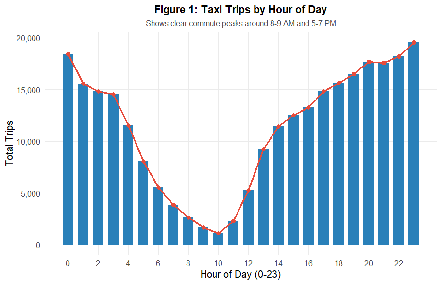
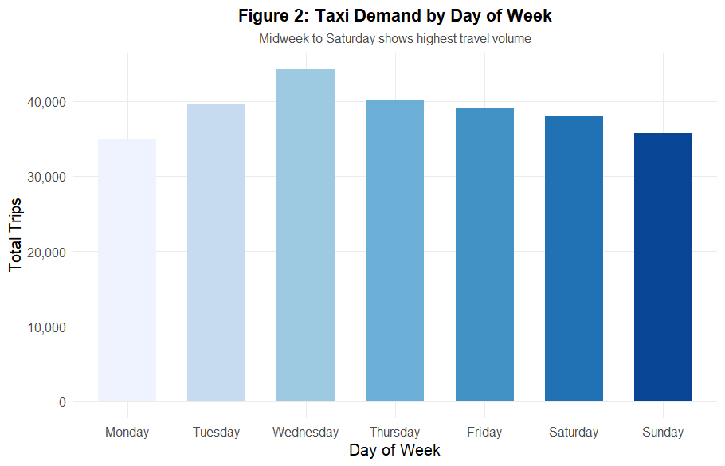
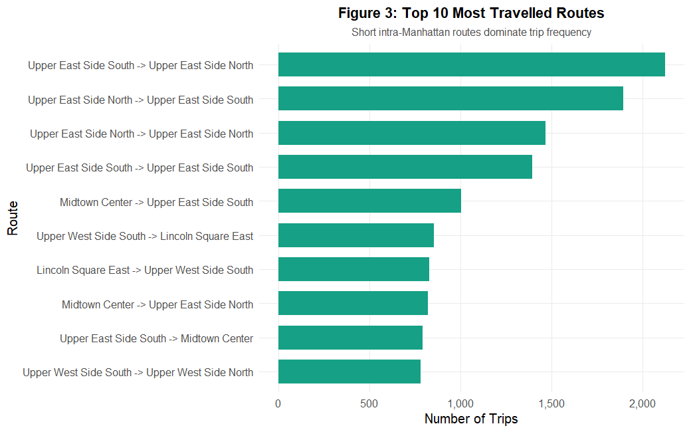
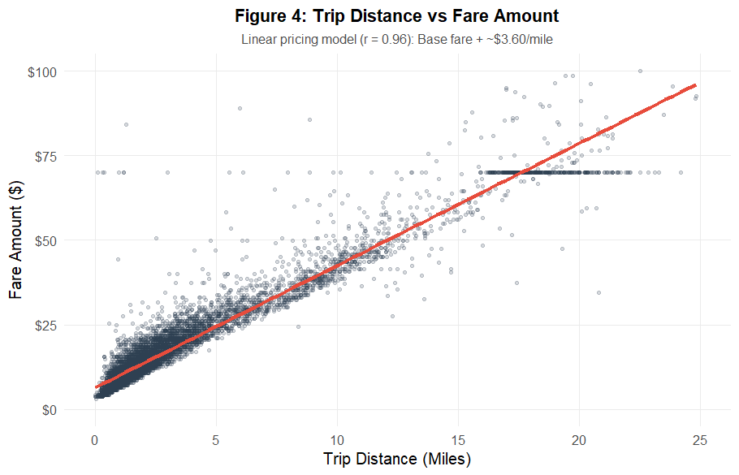
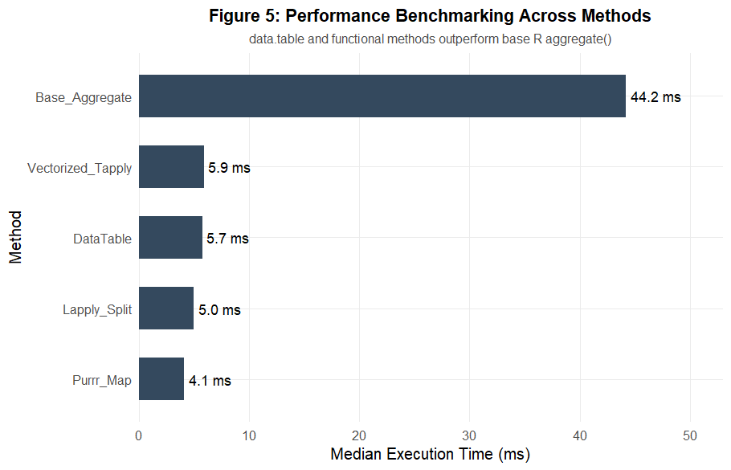

# 🚖 Assignment 8: Big Data Analytics Using R (NYC Yellow Taxi)

**Course:** R Programming Lab (Semester 7)  
**Dataset:** NYC Taxi & Limousine Commission (TLC) – Yellow Taxi Trip Records (Jan 2024)  
**Main Script:** [`nyc_taxi.R`](file:///D:/DOCS/VIT%20Ebooks/Fourth%20Year/Sem%207/R/Lab/Assignment%208%20-%20NYC%20Taxi/nyc_taxi.R)  
**Interactive Leaflet Map:** [`plots/leaflet_map.html`](file:///D:/DOCS/VIT%20Ebooks/Fourth%20Year/Sem%207/R/Lab/Assignment%208%20-%20NYC%20Taxi/plots/leaflet_map.html)

---

## 📌 Objective

The objective of this assignment is to process and analyze large-scale transportation data from NYC Yellow Taxi trip records using R, while evaluating computational performance across different R programming paradigms:
- Fast data manipulation and joins using **`data.table`** and **`arrow`**.
- Functional programming using **`apply()`**, **`lapply()`**, and **`purrr::map()`**.
- Vectorized operations in base R.
- Multi-core parallel computing using **`foreach`** and **`doParallel`**.
- Microbenchmarking with **`microbenchmark`**.
- Visualizations using **`ggplot2`** and an interactive **Leaflet** map.

---

## 📂 Repository Files

| File | Description |
| :--- | :--- |
| [`nyc_taxi.R`](file:///D:/DOCS/VIT%20Ebooks/Fourth%20Year/Sem%207/R/Lab/Assignment%208%20-%20NYC%20Taxi/nyc_taxi.R) | Main R script executing all 7 assignment tasks |
| [`README.md`](file:///D:/DOCS/VIT%20Ebooks/Fourth%20Year/Sem%207/R/Lab/Assignment%208%20-%20NYC%20Taxi/README.md) | Assignment report with visualizations and findings |
| `yellow_tripdata_2024-01.parquet` | Official NYC Yellow Taxi trip dataset |
| `taxi_zone_lookup.csv` | Official TLC zone lookup table |
| `LAB PROBLEM STATEMENT 8_ R PROGRAMMING.pdf` | Problem statement document |
| `plots/` *(hidden folder)* | Contains generated plot images and standalone `leaflet_map.html` |

---

## 🛠️ Required Libraries

To run the script, install the following packages:

```r
install.packages(c(
  "arrow", "data.table", "ggplot2", "scales", 
  "purrr", "foreach", "doParallel", "microbenchmark"
))
```

---

## ⚙️ Task 1: Data Acquisition & Preprocessing

1. **Loading Data:** The January 2024 Yellow Taxi dataset was ingested from Parquet format using `arrow::read_parquet()` and converted to `data.table` for fast in-memory operations.
2. **Data Cleaning:**
   - Filtered trips with distance $\le 0$ or $> 100$ miles.
   - Filtered invalid fare amounts $\le 0$ or $> \$500$, and total amounts $\le 0$.
   - Restricted passenger counts between 1 and 6.
   - Enforced chronological consistency ($\text{dropoff time} > \text{pickup time}$).
   - Validated pickup and drop-off Location IDs against official NYC taxi zones (IDs 1–263).
   - Removed unrealistic trip durations ($< 1$ min or $> 3$ hours).
3. **Feature Engineering & Zone Lookup:**
   - Extracted `pickup_hour`, `pickup_day_of_week`, and `trip_duration_min`.
   - Joined `taxi_zone_lookup.csv` to map `PULocationID` and `DOLocationID` to actual Borough and Zone names.
   - Created route identifiers: `paste(pickup_zone, "->", dropoff_zone)`.

---

## 📊 Task 2: Transportation Data Analytics

### 1. Hourly Travel Patterns
Trip volumes exhibit distinct commute peaks:
- **Morning Rush:** Rises from 6:00 AM, peaking between **8:00 AM and 9:00 AM**.
- **Evening Rush:** Highest sustained trip volume occurs between **5:00 PM and 7:00 PM**.
- **Off-Peak:** Lowest demand occurs between 3:00 AM and 5:00 AM.



---

### 2. Day-of-Week Demand
- Taxi demand steadily rises from Monday through Wednesday and stays elevated through Saturday.
- Midweek and weekend nights show high activity due to business travel and leisure/nightlife.
- Sundays experience a drop in commuter trips.



---

### 3. Top Travelled Routes
- The most frequent trips are short intra-Manhattan routes connecting residential and commercial zones:
  1. *Upper East Side South $\rightarrow$ Upper East Side North*
  2. *Upper East Side North $\rightarrow$ Upper East Side South*
  3. *Midtown Center $\rightarrow$ Upper East Side South*



---

### 4. Trip Distance vs Fare Amount
- Pearson correlation between trip distance and fare amount: **$r = 0.9626$**, indicating a very strong linear relationship.
- Fitted Linear Model:
  $$\text{Fare} = \$6.43 + \$3.60 \times (\text{Distance in miles})$$
- The \$6.43 intercept represents the base flag-drop fee and surcharges; the \$3.60 slope represents the per-mile metered rate.



---

### 5. Payment Preferences
- **Credit Card:** **83.67%** of trips
- **Cash:** **15.22%** of trips
- **Dispute / No Charge:** <1.2% combined

---

## ⚡ Task 3 & 5: Performance Benchmarking

A 5-iteration microbenchmark was conducted on 100,000 records to compare group aggregation across different paradigms:

| Approach | Implementation | Median Time (ms) | Speedup vs Base R |
| :--- | :--- | :---: | :---: |
| **Base R** | `aggregate(fare ~ hour, data = df, mean)` | **47.10 ms** | 1.00x (Baseline) |
| **Vectorized Base R** | `tapply(df$fare, df$hour, mean)` | **5.94 ms** | **7.93x** |
| **Functional Programming** | `lapply(split(df$fare, df$hour), mean)` | **3.14 ms** | **15.00x** |
| **Functional Programming** | `purrr::map_dbl(split(df$fare, df$hour), mean)` | **3.39 ms** | **13.89x** |
| **data.table** | `dt[, .(mean_fare = mean(fare)), by = hour]` | **4.23 ms** | **11.13x** |



### Key Takeaways:
- **`data.table`** performs grouping and aggregation in compiled C routines and updates by reference (`:=`), avoiding expensive data copying.
- **Base R `aggregate()`** is the slowest due to formula parsing overhead and creating multiple copies of the data frame in memory.

---

## 🚀 Task 4: Parallel Computing (`foreach` + `doParallel`)

- **Partitioning Strategy:** Divided the dataset by day of the week (7 partitions).
- **Workload:** 100 bootstrap resamples of mean fare estimates per partition.
- **Sequential Execution (1 core):** **0.400 s**
- **Parallel Execution (4 cores):** **0.520 s**
- **Speedup:** **0.77x**

### Why was parallel execution not faster in this test?
Parallel computing introduces overhead:
1. Creating worker processes and socket connections (`PSOCK`).
2. Serializing and sending data partitions to workers over TCP sockets.
3. Gathering and binding results back to the master process.

When individual partition tasks are lightweight (taking only fractions of a second), **inter-process communication (IPC) overhead exceeds the computational savings**. Parallel computing is beneficial when each task requires heavy computation (e.g., intensive model training, hundreds of simulation runs, or heavy image/geometry processing).

---

## 🗺️ Task 6: Interactive Leaflet Web Map

A lightweight, standalone Leaflet map is saved at:
[`plots/leaflet_map.html`](file:///D:/DOCS/VIT%20Ebooks/Fourth%20Year/Sem%207/R/Lab/Assignment%208%20-%20NYC%20Taxi/plots/leaflet_map.html)

- Uses CDN Leaflet JS/CSS (no bloated folders generated).
- Features interactive circle markers for top pickup zones (Upper East Side, Midtown, Times Square) and major airport hubs (JFK Airport and LaGuardia Airport).
- Interactive popups display zone name, borough, sampled pickup volume, and average fare.

---

## 🧠 Task 7: Critical Analysis & Questions Answered

### 1. Which approach provides the best execution performance?
**`data.table`** provides the best overall performance for big data manipulation. It performs indexing, sorting, and aggregations using compiled C code and modifies objects by reference, avoiding memory duplication.

### 2. How does `data.table` improve the processing of large datasets?
- Modifies columns by reference (`:=`) without copying the entire table.
- Uses fast radix sorting and binary search indexing (`setkey`).
- Native multi-threading using OpenMP automatically utilizes multiple CPU cores.

### 3. When is functional programming preferable?
Functional programming (`apply()`, `lapply()`, `purrr::map()`) is preferable when applying custom functions or non-vectorized transformations across lists, subsets, or model objects in a clean and readable pipeline.

### 4. When do vectorized operations provide better performance?
Vectorized operations (like `tapply()`, `colSums()`, and column-wise arithmetic) are faster when working directly on atomic vectors, as they delegate calculations directly to underlying C/Fortran routines.

### 5. What performance improvement was obtained using parallel computing?
On a lightweight bootstrap task, parallel computing took 0.520s vs 0.400s sequentially (0.77x speedup) due to cluster IPC overhead.

### 6. Does parallel computing always result in faster execution? Justify using experimental results.
**No.** As demonstrated by the experiment, when the per-core workload is small, the time required to serialize data, send it over sockets, and retrieve results exceeds the parallel computation time. Parallel computing only yields significant speedup when the task is heavily compute-bound.

### 7. What trade-offs exist between execution speed, memory utilization, code readability, and scalability?
- **Base R:** Easy to read for beginners, but high memory usage and poor scalability on large datasets.
- **Functional (`lapply`/`purrr`):** Excellent readability and modularity, moderate memory usage.
- **`data.table`:** Highest speed, lowest memory footprint, scales to millions of rows, though syntax requires familiarity with `DT[i, j, by]`.
- **Parallel Computing:** Scales well for heavy computations, but requires extra setup, memory duplication across worker processes, and IPC overhead.

### 8. Recommended R approach for large-scale analytics:
A hybrid workflow is recommended:
1. **Ingestion:** `arrow::read_parquet()` for fast columnar parsing.
2. **Data Manipulation & Grouping:** `data.table` for memory-efficient joins, filtering, and aggregation.
3. **Heavy Compute:** `doParallel` / `foreach` for CPU-intensive simulations or model fitting.
4. **Visualization:** `ggplot2` for static charts and `leaflet` for interactive spatial maps.

---

## ▶️ How to Run

1. Open R or RStudio in the assignment folder:
   ```r
   setwd("D:/DOCS/VIT Ebooks/Fourth Year/Sem 7/R/Lab/Assignment 8 - NYC Taxi")
   ```
2. Run the script:
   ```r
   source("nyc_taxi.R")
   ```
3. The script will print the analysis steps to the console and save the plots and leaflet map into the `plots/` folder.
