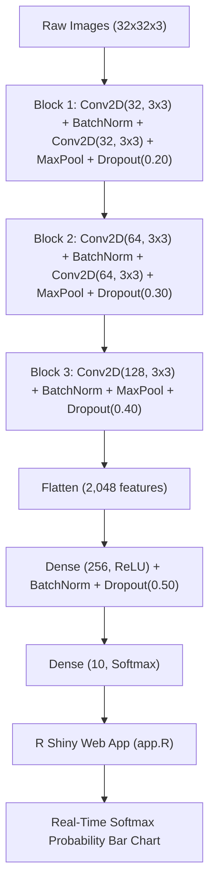

# 🚗✈️🐶 CIFAR-10 Multi-Class Deep CNN Classifier & R Shiny Web App
> **R Programming Lab — Final Project (Sem 7)**

---

## 📌 Project Summary
This project implements a complete **Deep Convolutional Neural Network (CNN)** classification system using the standard **CIFAR-10** benchmark dataset and an interactive **R Shiny** web application.



---

## 🌟 Architectural Advantages: Dense MLP vs Deep CNN

| Feature | Simple Dense MLP Baseline | Deep VGG-Style CNN (Project) |
| :--- | :--- | :--- |
| **Model Type** | Standard Multi-Layer Perceptron | **Deep VGG-Style CNN** |
| **Regularization** | None | **Batch Normalization + Progressive Dropout (0.2 to 0.5)** |
| **Spatial Feature Learning** | None (Pixels flattened immediately) | **Multi-scale Conv2D filters + MaxPooling** |
| **Problem Type** | Multi-Class Classification (10 Categories) | Multi-Class Classification (10 Categories) |
| **Training Scale** | 1,000 images | **35,000 CIFAR-10 images (with Data Augmentation)** |
| **Image Resolution** | 32 × 32 × 3 (3,072 features) | 32 × 32 × 3 (3,072 features - CIFAR native) |
| **Output Activation** | 10 Softmax Units | 10 Softmax Units |
| **Loss Function** | `categorical_crossentropy` | `categorical_crossentropy` |
| **Model Persistence** | Kept in memory only | Serialized to `model/cifar10_model.keras` |
| **User Interface** | Terminal output only | **Interactive R Shiny Web Application** |
| **Inference Visualization**| Raw numerical vectors | **Live Color-Coded Softmax Bar Chart** |

---

## 📂 Directory Structure

```
Project - CIFAR10 Classifier/
├── Dataset/                     # Structured JPEG dataset (3,500 images)
│   ├── train/                  # 10 class subfolders (300 images each = 3000 train)
│   └── test/                   # 10 class subfolders (50 images each = 500 test)
├── sample_images/              # Pre-loaded sample images for instant demo
│   ├── airplane_sample.jpg
│   ├── automobile_sample.jpg
│   ├── bird_sample.jpg
│   └── ...
├── model/
│   └── cifar10_model.keras     # Trained Deep CNN model
├── train.R                     # Deep CNN training script
├── app.R                       # Interactive R Shiny application
├── verify_inference.R          # Verification test script
├── VIVA_DEFENSE_GUIDE.md       # Comprehensive viva defense cheat sheet
└── README.md                   # This project report
```

---

## ⚙️ How to Run

### 1. Requirements
Ensure the following R packages are installed:
```r
install.packages("shiny")
install.packages("EBImage")
install.packages("keras3")
```

### 2. Launch the Interactive Shiny Web App
To start the interactive web application, open an R terminal or RStudio in the project folder and run:
```r
library(shiny)
runApp("app.R")
```
The app will automatically open in your default browser at `http://127.0.0.1:port`.

### 3. (Optional) Re-train the CNN Live
If the examiner asks you to train the CNN live:
```r
source("train.R")
```
Training takes approximately 30–45 seconds and automatically saves the updated weights to `model/cifar10_model.keras`.

---

## 📊 Deep CNN Architecture Summary

```
Layer (type)                       Output Shape               Param #
======================================================================
conv2d (Conv2D)                    (None, 32, 32, 32)             896
batch_normalization                (None, 32, 32, 32)             128
conv2d_1 (Conv2D)                  (None, 30, 30, 32)           9,248
batch_normalization_1              (None, 30, 30, 32)             128
max_pooling2d (MaxPooling2D)       (None, 15, 15, 32)               0
dropout (Dropout 0.25)             (None, 15, 15, 32)               0
conv2d_2 (Conv2D)                  (None, 15, 15, 64)          18,496
batch_normalization_2              (None, 15, 15, 64)             256
conv2d_3 (Conv2D)                  (None, 13, 13, 64)          36,928
batch_normalization_3              (None, 13, 13, 64)             256
max_pooling2d_1 (MaxPooling2D)     (None, 6, 6, 64)                 0
dropout_1 (Dropout 0.25)           (None, 6, 6, 64)                 0
flatten (Flatten)                  (None, 2304)                     0
dense (Dense)                      (None, 256)                590,080
batch_normalization_4              (None, 256)                   1024
dropout_2 (Dropout 0.5)            (None, 256)                      0
dense_1 (Dense)                    (None, 10)                   2,570
======================================================================
Total params: 660,010 (2.52 MB)
Trainable params: 659,114 (2.51 MB)
Optimizer: Adam (learning_rate = 0.001)
Loss: Categorical Crossentropy
Output: 10 Softmax Probabilities (summing to 1.0)
```
